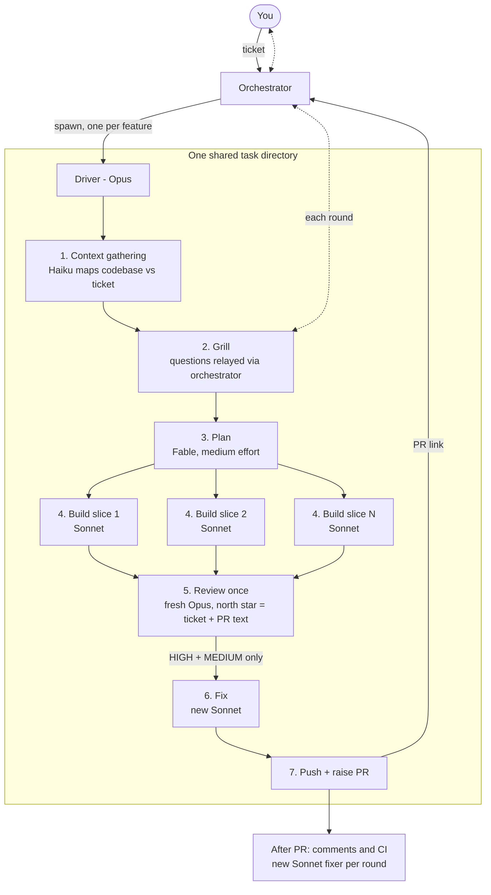

# Feature and fix pipeline

From a Linear ticket to a raised PR. One Opus **driver** per feature or fix; the orchestrator (e.g. Firstmate) runs many drivers at once. Agent-facing steps: [`skills/context-gathering`](../skills/context-gathering/SKILL.md).

## Models

| Stage | Model | Why |
|---|---|---|
| Driver | Opus | Judgment across the whole lifecycle; coordinates only, so token spend stays small |
| Context gathering | Haiku | Cheap, wide codebase reading |
| Plan | Fable, medium effort | Strong planning from ticket + map + Q&A |
| Build, fix | Sonnet | Implementation |
| Review | Opus, once per PR | Independent judgment without build context |

## Rules

- **One directory.** Every sub-agent runs inside the driver's session, so the mapper, builders, reviewer, and fixers all share one working copy.
- **Parallel only when safe.** Build slices run in parallel when they touch different files; slices sharing a file run in sequence.
- **Review once, when ready.** The Opus review starts only after the whole change is written and the branch is ready to raise. Fixes after it get no second Opus pass unless asked.
- **Fix threshold.** HIGH and MEDIUM findings are fixed before the PR; LOW findings are optional follow-ups.
- **The driver never talks to the user directly.** Grill rounds and outcomes go through the orchestrator.
- **One owner per PR.** After the PR is raised, the same driver handles reviewer comments and CI with new Sonnet fixers.
