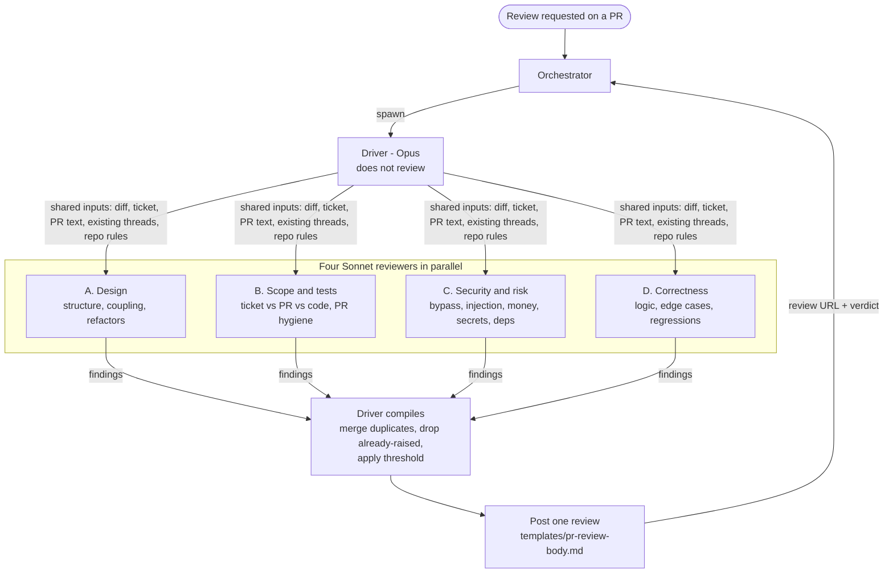

# PR review pipeline

Reviewing a PR that requests your review. One Opus **driver** per PR compiles; four Sonnet reviewers review. Agent-facing steps: [`skills/pr-review-driver`](../skills/pr-review-driver/SKILL.md).

## Threshold

- Any HIGH, or more than 5 MEDIUM: request changes.
- Otherwise approve; MEDIUM items are recommended non-blockers, LOW / NIT are optional follow-ups.

## Rules

- The driver judges evidence, not code; when two lenses disagree on severity it keeps the better-evidenced one.
- Reviewers return findings only; the driver posts exactly one review.
- On a PR you did not author: review and comment only. No edits to title or description, no merge, no branch update, no push, no resolving other people's threads, no ticket changes.
- A new review runs only when the author re-requests review.
